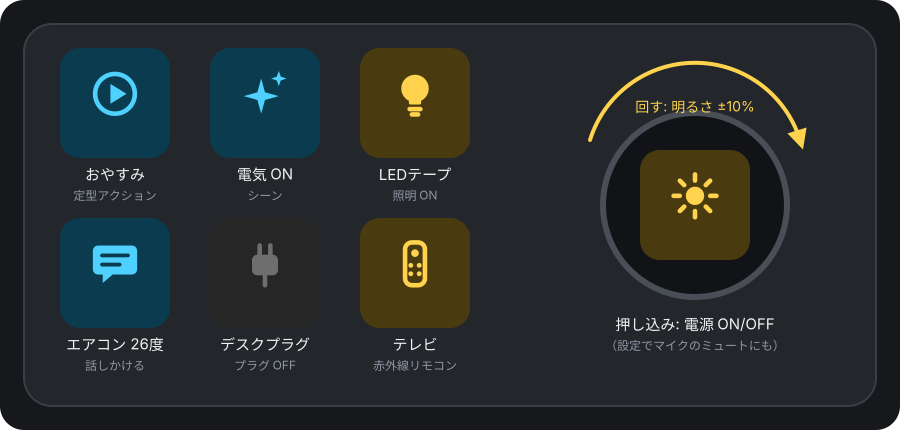
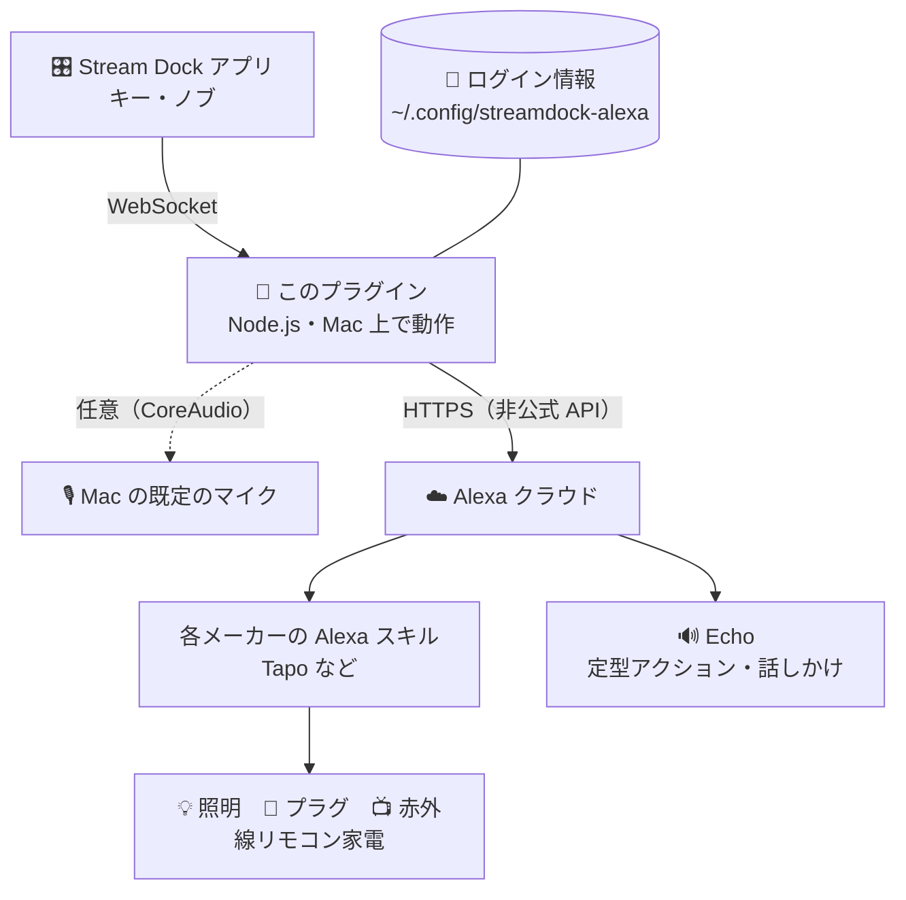
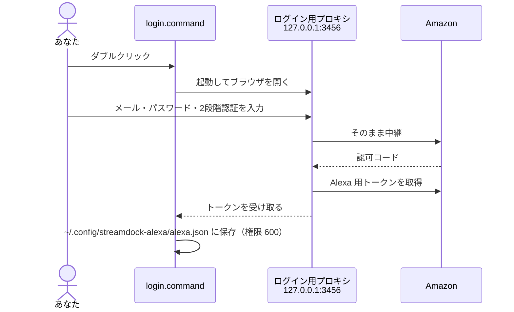

# Alexa Smart Home for Stream Dock

Stream Dock（AJAZZ / Mirabox）のキーとノブから、**Alexa の定型アクション**を実行したり、**Alexa につないだスマートホーム機器（Tapo のプラグ・LED テープ・スマートリモコンなど）**を操作したりできるプラグインです。

[English summary](#english)



- 🎬 **定型アクションをワンタッチで実行**：「おやすみ」「ただいま」など、Alexa アプリで作った定型アクションをキーに割り当てられます。照明・家電・音楽などをまとめて動かす操作も、キー1つで実行できます。
- 🎛 **ノブで明るさを調整**：回すと照明の明るさが ±5〜20% ずつ変わり、押し込むと ON/OFF します。押し込みは、マイクのミュート切替に変えることもできます。
- 💡 **機器の ON/OFF とシーン**：照明・プラグは今の状態をキーに表示します。Tapo の「スマートアクション」やスマートリモコン（H110 など）の家電も操作できます。
- 💬 **Alexa に話しかける**：「エアコンを26度にして」などの文を、声を出さずに送れます。

> [!IMPORTANT]
> このプラグインは Amazon の**非公式 API** を使っています。Amazon・TP-Link・AJAZZ とは無関係で、Amazon 側の変更によって予告なく動かなくなることがあります。

---

## 目次

- [できること](#できること)
- [仕組み](#仕組み)
- [必要なもの](#必要なもの)
- [インストール](#インストール)
- [Amazon にログインする](#amazon-にログインする)
- [使い方](#使い方)
- [Tapo で使うときのコツ](#tapo-で使うときのコツ)
- [トラブルシューティング](#トラブルシューティング)
- [セキュリティとプライバシー](#セキュリティとプライバシー)
- [アンインストール](#アンインストール)
- [開発者向け](#開発者向け)
- [English](#english)

## できること

| | アクション | 置き場所 | 押す・回すと | 設定する項目 |
|:-:|---|---|---|---|
|  | **Alexa 定型アクション** | キー | 定型アクションを実行 | 定型アクション、実行する Echo |
|  | **スマートホーム明るさ** | ノブ | 回す：明るさ<br>押し込み：電源（またはマイクのミュート） | 照明、1目盛りの量、押し込みの動作 |
|  | **スマートホーム電源** | キー | ON/OFF 切替（シーンは実行） | 機器、押したときの動作（切替 / 常に ON / 常に OFF） |
|  | **Alexa に話しかける** | キー | 文を Alexa に送る | 話す内容、実行する Echo |

**電源キーは機器の種類と状態でアイコンが変わります。**

| 照明 ON | 照明 OFF | プラグ ON | プラグ OFF | リモコン家電 | シーン | 要ログイン | マイク OFF |
|:-:|:-:|:-:|:-:|:-:|:-:|:-:|:-:|
|  |  |  |  |  |  |  |  |

キーを押した結果は、成功するとキーに ✓、失敗すると ⚠ が一瞬表示されます。

## 仕組み

このプラグインは Tapo などの機器に直接つなぐのではなく、**Alexa を経由**して操作します。そのため、Alexa アプリで操作できる機器なら、メーカーを問わず使えます。



| 操作 | 流れ | かかる時間の目安 |
|---|---|---|
| 電源・明るさ | プラグイン → Alexa → メーカーのクラウド → 機器 | 1〜2 秒 |
| 定型アクション・話しかけ | プラグイン → Alexa → Echo が実行 | 1〜3 秒 |
| マイクのミュート | Mac の中だけで完結（ネット不要） | 一瞬 |

## 必要なもの

| もの | 備考 |
|---|---|
| macOS 12 以降 | Windows には対応していません |
| Stream Dock アプリ 3.10 以降 | AJAZZ 版（Stream Dock AJAZZ 3.10.188）と AKP03E で動作を確認しています。Mirabox 版も同じプラグイン形式ですが、未確認です。ノブのアクションは、ノブのある機種で使えます |
| Node.js 18 以降 | インストール時の `npm install` に使います。`brew install node` で入ります。プラグインの実行時には、Stream Dock に同梱の Node.js が使われます |
| Amazon アカウント | Alexa に機器を登録済みであること（Tapo なら Alexa アプリで Tapo スキルを有効にする） |
| Echo などの Alexa 端末（任意） | 定型アクションと「話しかける」の実行に使います。電源・明るさだけなら不要です |
| Xcode Command Line Tools（任意） | ノブでマイクをミュートしたい場合だけ必要です。`xcode-select --install` で入ります |

## インストール

```bash
git clone https://github.com/yahato2474/streamdock-alexa-smarthome.git
cd streamdock-alexa-smarthome
./install.sh
```

`install.sh` は次の処理を行います。

1. 依存パッケージを入れる（`npm install`）。このとき、ログイン用ライブラリに[小さな修正](#日本の-amazon-でログインが終わらない問題への対処)を当てます
2. Xcode Command Line Tools があれば、マイク用の小さなヘルパー（`bin/micmute`）をビルドする
3. プラグインを Stream Dock のプラグインフォルダ（`~/Library/Application Support/HotSpot/StreamDock/plugins/`）にコピーする
4. Stream Dock の再起動と、Amazon へのログインをするか尋ねる

インストールが終わったら、Stream Dock 右側のアクション一覧の **「Alexa スマートホーム」**（英語表示では "Alexa Smart Home"）から、キーやノブにドラッグして配置します。

## Amazon にログインする

最初の1回だけ、Amazon にログインします。ログイン情報（トークン）は Mac の中だけに保存され、このリポジトリの作者を含む第三者には送られません。

1. `tools/login.command` をダブルクリックする。インストールの最後に「Log in to Amazon now?」で `y` を押しても同じです。未ログインのキーを押しても開きます
2. 使っている Amazon のドメインを番号で選ぶ（日本なら `amazon.co.jp`）
3. ブラウザで **http://127.0.0.1:3456/** が開くので、Amazon にログインする
4. 「ログイン情報を保存しました」と表示されれば完了です



> [!TIP]
> - アドレスバーが **`127.0.0.1:3456`** のままの画面でログインしてください。途中で `www.amazon.co.jp` などに変わった画面でログインしても、トークンは取得できません。
> - **パスキーではなくパスワード**でログインしてください（プロキシ経由ではパスキーが使えないことがあります）。
> - うまくいかないときは、ブラウザの**プライベートウィンドウ**で開き直してください。

ログイン情報は、プラグインが自動で更新します。Amazon 側で無効になった（パスワード変更など）ときは、キーに「要ログイン」と表示されます。そのキーを押すと、同じ手順でログインし直せます。

## 使い方

各アクションをキーやノブに置いたら、右側の設定欄で項目を選びます。機器・定型アクション・Echo の一覧は、Alexa から自動で読み込まれます。

### Alexa 定型アクション

| 項目 | 説明 |
|---|---|
| 定型アクション | Alexa アプリで作った定型アクションから選びます |
| 実行する Echo | 定型アクション内の「話す」「音楽を流す」などを行う端末です。「自動」ならオンラインの Echo を優先して選びます |
| 表示名 | キーに表示する名前です。空欄なら定型アクション名を表示します |

**おすすめの使い方**：照明・エアコン・テレビをまとめて切る「おやすみ」や、作業用の照明と音楽を流す「集中モード」などを定型アクションとして作り、キー1つで呼び出す。

### スマートホーム明るさ（ノブ）

| 項目 | 説明 |
|---|---|
| 機器 | 明るさを変えられる照明だけが一覧に出ます |
| 1目盛り | 1クリックで変える量（5 / 10 / 20%）。素早く回した分は、まとめて1回で送ります |
| 押し込み | **電源を切替**（既定）または **マイクのミュート切替** |

マイクのミュートは、macOS の「既定の入力デバイス」に対して行います。ミュート時は「ボトル」、解除時は「ティン」の音が鳴ります。ノブには画面がないので、状態は音とアプリ上の表示（マイクのアイコンと「マイクOFF」）で確認します。

### スマートホーム電源

| 項目 | 説明 |
|---|---|
| 機器 | Alexa に登録されたすべての機器とシーンが選べます |
| 押したとき | ON/OFF 切替・常に ON・常に OFF |

- 照明やプラグは、Alexa から実際の状態を取得してアイコンに反映します（30秒ごとに更新）
- 赤外線リモコンの家電のように状態がわからない機器は、押すたびに ON と OFF を交互に送ります
- **シーン**（Tapo のスマートアクションなど）は、押すと実行されます

### Alexa に話しかける

「リビングの電気を50%にして」「エアコンを除湿にして」など、Alexa に声で言うのと同じ文を送ります。定型アクションや機器設定にない細かい操作に便利です。Echo が返事を声で返すことがあります。

## Tapo で使うときのコツ

1. Alexa アプリで **Tapo スキル**を有効にし、Tapo のアカウントとリンクします
2. Tapo アプリで機器を追加すると、Alexa にも自動で現れます
3. 機器が一覧に出ないときは、Alexa アプリの「デバイスを検出」を実行してから、キーの設定欄を開き直してください

| Tapo の機能 | Alexa 上での見え方 | 使うアクション |
|---|---|---|
| スマートプラグ（P105 など） | プラグ | 電源 |
| LED テープ・電球（L900 など） | 照明（明るさ対応） | 電源・明るさ |
| スマートリモコン（H110 など）で登録した家電 | テレビ・エアコンなど | 電源（ON/OFF を交互に送る） |
| スマートアクション | シーン | 電源（押すと実行） |

> [!NOTE]
> Tapo の新しいファームウェアでは、LAN 内から直接操作する従来の方法（KLAP）が使えなくなっています。このプラグインが Alexa 経由で操作するのはそのためです。

## トラブルシューティング

| 症状 | 原因と対処 |
|---|---|
| キーに「要ログイン」と出る | 未ログインか、ログインの期限切れです。キーを押すか `tools/login.command` を実行してください |
| ログイン後に Amazon の「お探しのページは見つかりません」になる | `127.0.0.1:3456` 以外の画面でログインしたか、古い Cookie が残っています。プライベートウィンドウで `http://127.0.0.1:3456/` を開き直してください |
| ⚠ が出て反応しない | `…/io.github.yahato2474.alexa.sdPlugin/log/plugin.log` を確認してください。`Too many requests` / `rate exceeded` なら、Amazon の回数制限です。1〜2分待つと戻ります |
| 機器が「(見つかりません)」 | Alexa 上で名前が変わった可能性があります。設定欄で選び直してください |
| マイクのミュートで ⚠ が出る | `bin/micmute` がありません。`xcode-select --install` の後に `./install.sh` を再実行してください |
| アクションが一覧に出ない | Stream Dock を再起動してください。それでも出ないときは、プラグインフォルダにコピーされているか確認してください |

## セキュリティとプライバシー

- ログイン情報は **`~/.config/streamdock-alexa/alexa.json`** に、自分だけが読める権限（600）で保存されます。この情報があれば Alexa を操作できるので、他人に渡さないでください
- ネットワーク通信の相手は Amazon だけです
- ログ（`log/plugin.log`）には操作の記録とエラーだけを残します。Amazon の応答内容（住所など）は書きません
- 使うのをやめるときは `./uninstall.sh --purge` でログイン情報を消し、Amazon の「コンテンツと端末」→「端末」に登録された端末（名前は **StreamDock Alexa**）を解除してください

## アンインストール

```bash
./uninstall.sh           # プラグインを削除
./uninstall.sh --purge   # ログイン情報も削除
```

## 開発者向け

```
streamdock-alexa-smarthome/
├── install.sh / uninstall.sh
├── assets/make-icons.js         アイコン生成（SVG → PNG、要 rsvg-convert）
├── docs/                        README 用の図
└── io.github.yahato2474.alexa.sdPlugin/
    ├── manifest.json, ja.json   アクション定義（英語・日本語）
    ├── plugin/
    │   ├── index.js             エントリーポイント
    │   ├── sd.js                Stream Dock との通信
    │   ├── actions.js           4つのアクションの処理
    │   ├── alexa.js             Alexa クライアント（alexa-remote2）
    │   ├── config.js            ログイン情報と Amazon ドメインの設定
    │   └── mic.js               マイクのミュート（bin/micmute を呼ぶ）
    ├── pi/                      設定欄（Property Inspector）
    ├── tools/                   ログイン・一覧表示・パッチ・micmute のソース
    └── test/                    ユニットテスト・結合テスト
```

```bash
cd io.github.yahato2474.alexa.sdPlugin
npm install
npm test                                            # ユニットテスト（ネットワーク不要）
npm run list                                        # Alexa の機器・定型アクション・Echo の一覧
TEST_LIGHT="照明の名前" node test/alexa.integration.js  # 実機での結合テスト（照明の状態は元に戻します）
node test/mic.integration.js                        # マイクのミュートの結合テスト
../install.sh --link                                # 開発用に、コピーではなくシンボリックリンクで入れる
```

プラグインのプロセスは、終了すると Stream Dock が自動で再起動します。`manifest.json` を変えたときは、アプリ自体の再起動が必要です。

### 日本の Amazon でログインが終わらない問題への対処

ログインには [alexa-remote2](https://github.com/Apollon77/alexa-remote) と [alexa-cookie2](https://github.com/Apollon77/alexa-cookie) を使っています。`amazon.co.jp` では、ログイン開始 URL の OAuth 拡張の名前空間が `www.amazon.co.jp` のままだと、Amazon がこの拡張を無視します。その結果、`openid.oa2.authorization_code` が返らず、ログインが終わりません。

そのため `npm install` の後に [`tools/patch-alexa-cookie.js`](io.github.yahato2474.alexa.sdPlugin/tools/patch-alexa-cookie.js) が自動で実行され、名前空間のホストを差し替えられるようにします。日本だけ `www.amazon.com` を使い、他の国は元の動作のままです。

## ライセンス

[MIT](LICENSE)。アイコンはこのリポジトリのオリジナルです（[`assets/svg`](assets/svg)）。依存パッケージ（alexa-remote2・alexa-cookie2・ws など）は、それぞれのライセンス（MIT など）に従います。

---

## English

**Alexa Smart Home for Stream Dock** lets AJAZZ / Mirabox Stream Dock keys and knobs **run Alexa routines** and **control any smart-home device linked to Alexa** (TP-Link Tapo plugs, light strips, IR remotes, scenes, …).

- **Alexa Routine** key – run a routine you built in the Alexa app.
- **Smart Home Brightness** knob – rotate to dim, push to toggle power (or mute the microphone).
- **Smart Home Power** key – on/off with live state, or run a scene.
- **Ask Alexa (text)** key – send any phrase as if you had said it.

Install on macOS with Node.js 18+:

```bash
git clone https://github.com/yahato2474/streamdock-alexa-smarthome.git
cd streamdock-alexa-smarthome && ./install.sh
```

Then double-click `tools/login.command`, pick your Amazon marketplace (amazon.com, amazon.de, amazon.co.jp, …) and sign in at `http://127.0.0.1:3456/` with your password (not a passkey). The token stays on your Mac (`~/.config/streamdock-alexa/alexa.json`, mode 600).

This project uses Amazon's **unofficial** Alexa web API. It may stop working at any time and is not affiliated with Amazon, TP-Link or AJAZZ. Japanese marketplace logins need a small patch to alexa-cookie2, which `npm install` applies automatically.
